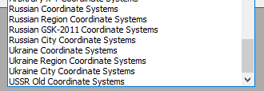

# Обновление библиотеки отечественных систем координат

*7 ноября 2026г.*

Настоящая статья содержит информацию об обновлениях в библиотеке отечественных систем координат для продуктов Autodesk и не только (с данной версии).

## Небольшой исторический экскурс

Так как определения систем координат для территории России и стран пост-советского пространства не являются открытыми и мало где публикуются официально (исключения для некоторых регионов), они не были включены в международную базу проекций EPSG и по сей день распространяются в виде неофициальных данных, подобранных\рассчитанных эмпирически.
В отношении продуктов Autodesk все продукты, предполагающие взаимодействие с геоданными, опираются на системные (фиксированы) и пользовательские определения. Вторые можно свободно создавать и редактировать, в том числе на базе системных определений из-под среды AutoCAD Civil 3D или AutoCAD Map 3D.
Первая (?) версия библиотеки определений МСК появилась до пакета адаптации 2019 года. В 2019 году была проведена масштабная работа по исправлениям определений, и фактически та версия определений с некоторыми небольшими доработками в 2020г. используется по сей день.

## Подходы к редактированию определений

Раннее все изменения в библиотеке определений СК делались только вручную, используя стандартные инструменты редактирования в AutoCAD Civil 3D. Скорость загрузки данных, скорость обновления, необходимость перезагрузки продукта являлись факторами, делающими процесс обновления неприятным. Вместе с тем возможен и иной сценарий работы - когда данные существуют в каком-угодно удобном виде, а для загрузки в Civil 3D используется формат на базе спецификации XML и набора имён "http://www.osgeo.org/mapguide/coordinatesystem" (ссылка не кликабельна, ведет на ресурс от начала 2010-х).

Только когда возникла задача массовых добавлений определений и добавления их в другой вид, для QGIS (proj.db) пришлось перейти ко второму способу взаимодействия, что и способствовало масштабному обновлению библиотеки СК

## Об обновлениях

Репозиторий с новыми материалами, из которых генерируются определения - https://github.com/GeorgGrebenyuk/MSK_RUS. Машиночитаемый перечень определений СК в табличном виде см. [тут](https://github.com/GeorgGrebenyuk/MSK_RUS/blob/main/SourceData/projectedCrsTransMercator.tsv), в человекочитаемом виде он же представлен [тут](https://github.com/GeorgGrebenyuk/MSK_RUS/blob/main/CONTENT.md). 

Скажем сразу - пакет определений не имеет обратной совместимости. Все определения были переименованы (кроме эллипсоидов), поэтому перед использованием данного пакета удалите систему координат из моделей. В противном случае у вас будут предупреждения при открытии старых файлов. Ниже информация об обновлениях:

- Всем определениям СК добавлен префикс государства, при котором данное определение вводилось. Раннее определения имели префикс `Russia`, он был сокращён до `RUS`;
- Определения из категории "зоны СК-63" теперь имеют префикс `USSR`, добавлены все возможные зоны, кроме районов B, H (Центральная Азия);
- Добавлены новые региональные СК, районные СК в пределах региона, городские и иные местные СК, некоторые в нескольких вариантах. В имени определения после префикса государства идёт код региона, а затем название города\района;
- Добавлены МСК регионов Украины (с начала-середины 2000х) префикс `UKR`;
- Переименованы референц-эллипсоиды и геодезические преобразования, убрано некорректное преобразование EPSG:1267 для СК-63;
- Добавлены 174 определения для ГСК-2011 (4 разных записей), копия с EPSG;
- Переписаны расширенные описания для всех определений, добавлен корректный перевод на английский вместо транслитерации символов, на русском идёт только в БД PROJ, т.к. пользовательская библиотека Autodesk сломается от кириллицы;
- Ко всем заимствованным определениям из EPSG добавлена соответствующая пометка в описание;

Было 387 определений МСК, теперь их 896:
- 174 для ГСК-2011;
- 545 региональных, городских СК для России;
- 33 определений для Украины включая 6 зон СК-63 в "их" редакции;
- 145 определений для СК-63;

Определения рассортированы по группам:


## Как происходит обновление (техническая информация)

Так как статьи я пишу и для себя, то зафиксирую здесь последовательность действий, как табличная информация преобразуется в наборы целевых файлов.

1. Закрыть файл `projectedCrsTransMercator.tsv`, если он открыт в каком-либо редакторе;
2. Запустить утилиту MskCsGeneratorCLI из набора [утилит](https://github.com/GeorgGrebenyuk/MskCsGenerationUtils) (перед этим задать путь к папке `MSK_RUS` в исходном коде);
3. Утилита генерирует файлы `AutodeskCSLibrary.xml`, `OsgeoProjDb.sql` в папке `SourceData`;
4. Из каталога `%LOCALAPPDATA%\Autodesk\User Geospatial Coordinate Systems` удалить все файлы `*.csd` из корня папки;
5. Запустить AutoCAD Civil 3D, командой `MAPCSLIBRARYIMPORT` указать сформированный `AutodeskCSLibrary.xml` в папке `SourceData`. На запрос "Импортировать все определения" - указать "Да";
6. Ждать несколько минут. Если вылетело - повторяете пункты 4-5 заново;
7. Смотрим внимательно на консоль:
```
Импортировано:
- Успешно 919 определений (903 СК)
- Пропущено 1 определений (0 СК)
- Сбой 0 определений (0 СК)
```
8. Если число определений СК не совпадает с файлом, то необходимо проверить, какое определение было пропущено.
9. Загружаем сборку `MskCsGenerationUtilsPlugin` из состава утилит и выполняем команду `MskCsUtils_CheckCs`, в консоли выведется имя сбойной или сбойных определений, которые далее надо будет внимательно просмотреть в исходном табличном файле;
10. Для группировки импортированных определений в тематические группы согласно табличному файлу выполните команду `MskCsUtils_CreateGroups` из загруженной на предыдущем шаге сборки;
11. Всё. Закройте Civil 3D, чтобы изменения подтянулись к файлам CSD, описывающим пользовательскую библиотеку СК
12. Скопируйте измененные `*.csd` файлы из корня `%LOCALAPPDATA%\Autodesk\User Geospatial Coordinate Systems` в нужное вам место или заархивируйте их; 
